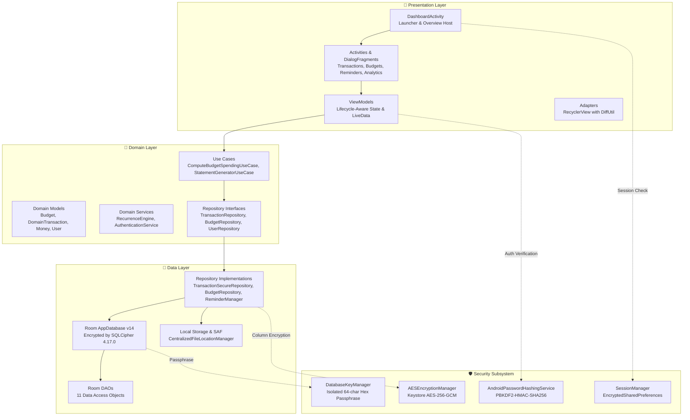
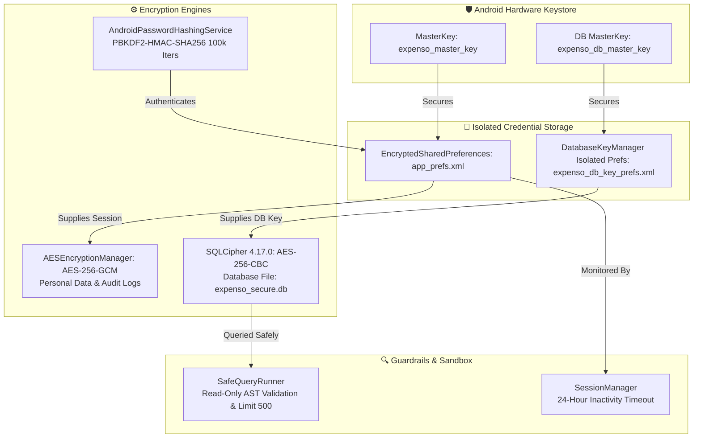
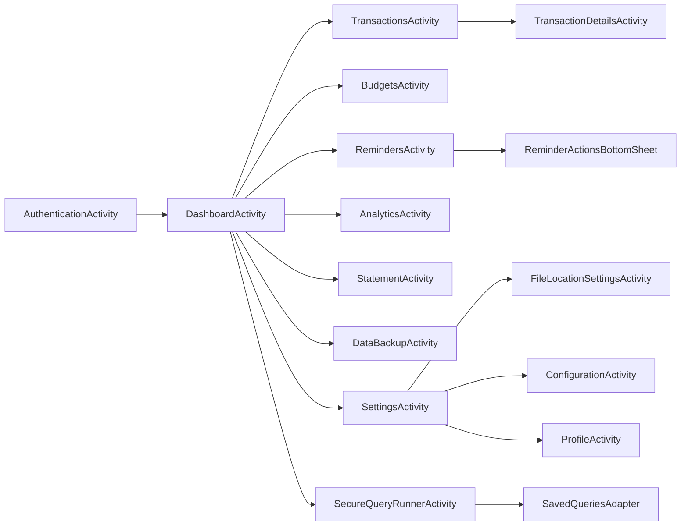
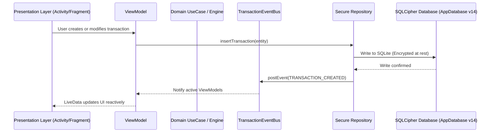

# Expenso

> **Modern Android Finance Management App** - 100% Offline, Zero-Telemetry, Enterprise-Grade Security

<p align="center">
  <a href="https://play.google.com/store/apps/details?id=com.offline.expenso">
    
  </a>
</p>

<p align="center">
  <a href="https://play.google.com/store/apps/details?id=com.offline.expenso"></a>
  <a href="https://developer.android.com"></a>
  <a href="https://www.oracle.com/java/"></a>
  <a href="https://www.zetetic.net/sqlcipher/"></a>
  <a href="https://developer.android.com/training/data-storage/room"></a>
  <a href="https://www.jacoco.org"></a>
  
</p>

---

## 📋 Table of Contents

1. [Overview](#-overview)
2. [Architecture](#-architecture)
3. [Security Architecture](#-security-architecture)
4. [Technology Stack](#-technology-stack)
5. [User Experience & Navigation](#-user-experience--navigation)
6. [Development & Project Structure](#-development--project-structure)
7. [Security Features](#️-security-features)
8. [Performance & Android 15+ Compatibility](#-performance--android-15-compatibility)
9. [Data Flow](#-data-flow)
10. [Analytics, Statements & Reminders](#-analytics-statements--reminders)
11. [Configuration & Backups](#-configuration--backups)
12. [Getting Started](#-getting-started)
13. [Documentation Index](#-documentation-index)
14. [Support](#-support)

---

## 🎯 Overview

**Expenso** is a comprehensive personal finance and expense management application for Android engineered around strict privacy, dual-tier cryptography, and 100% offline autonomy. It requires zero network permissions, communicates with no remote servers, and executes all database queries, financial analytics, statement generation, and data backups entirely on-device.

### ✨ Key Features

- **🔒 Dual-Tier Security** - SQLCipher 4.17.0 full database page encryption combined with Android Keystore AES-256-GCM.
- **📱 Material Design 3 UI** - Dynamic theming (Light/Dark/System), custom typography, and edge-to-edge layout.
- **🏗️ Clean Architecture + MVVM** - Domain-driven design with reactive `TransactionEventBus` and Service Locator (`AppContainer`).
- **💾 100% Offline & Zero Telemetry** - Absolute privacy; no analytics pings, no cloud sync, and no tracking SDKs.
- **⏰ Payment Reminder System** - Exact time-sensitive reminders via `AlarmManager` with interactive notification actions (Mark as Paid, Snooze).
- **📊 Offline Financial Analytics** - In-memory cash flow calculations, savings rates, MoM/YoY trends, and MPAndroidChart visualizations.
- **📄 Offline PDF Statement Generator** - Multi-page financial statements powered by iText7 with intelligent pagination space budgeting.
- **🔄 Multi-Table ZIP Backup & Restore** - Complete export/import of all data tables (CSV format packaged with `manifest.json`) supporting Replace and Merge modes.
- **💻 Safe Query Runner** - Direct SQL console for transactions with AST-based read-only sandboxing, user isolation, and saved query support.

---

## 🏗️ Architecture

Expenso adheres to **Clean Architecture** principles decoupled into distinct presentation, domain, and data layers:



---

## 🔒 Security Architecture

Expenso isolates cryptographic keys and user secrets to prevent cascading failures:



---

## 🚀 Technology Stack

### Core Technologies
- **Language**: Java 17 (100% core logic with Kotlin for test helpers/build scripts)
- **Android SDK**: `compileSdk = 36`, `targetSdk = 36`, `minSdk = 24` (Android 7.0+)
- **Build System**: Gradle 8.11.1 with Android Gradle Plugin 8.9.0
- **Database**: Room `2.6.1` + SQLCipher `4.17.0` (Current DB Version: `14`)
- **Native Support**: 16KB memory page alignment (`armeabi-v7a`, `arm64-v8a`, `x86`, `x86_64`)
- **Coverage Requirement**: Jacoco `0.8.11` enforcing **85% line coverage minimum**

### Key Libraries
- **SQLCipher for Android** (`net.zetetic:sqlcipher-android:4.17.0`)
- **AndroidX Security Crypto** (`androidx.security:security-crypto:1.1.0-alpha06`)
- **AndroidX Biometric** (`androidx.biometric:biometric:1.1.0`)
- **AndroidX WorkManager** (`androidx.work:work-runtime:2.9.0`)
- **iText7 Core** (`com.itextpdf:itext7-core:8.0.5`)
- **MPAndroidChart** (`com.github.PhilJay:MPAndroidChart:v3.1.0`)
- **Google Play App Update** (`com.google.android.play:app-update:2.1.0`)

---

## 📱 User Experience & Navigation



### Complete Activity Navigation Matrix:
1. **[`DashboardActivity`](docs/USER_GUIDE.md#dashboard)** - Launcher host, financial cards, quick actions, recent entries, shimmer loading.
2. **[`TransactionsActivity`](docs/USER_GUIDE.md#managing-transactions)** - Paginated transactions, search, date range, swipe actions.
3. **[`BudgetsActivity`](docs/USER_GUIDE.md#budget-tracking)** - Recurring budget cards, threshold warnings, drag-and-drop ordering, history viewer.
4. **[`RemindersActivity`](docs/USER_GUIDE.md#payment-reminders)** - Upcoming and historical payment reminder tabs, snooze/paid toggles.
5. **[`AnalyticsActivity`](docs/USER_GUIDE.md#financial-analytics)** - Interactive cash flow and category distribution charts via MPAndroidChart.
6. **[`StatementActivity`](docs/USER_GUIDE.md#pdf-statements)** - Multi-page PDF statement generation with date range filters.
7. **[`DataBackupActivity`](docs/USER_GUIDE.md#data-backup--restore)** - ZIP backup export and merge/replace restoration.
8. **[`SecureQueryRunnerActivity`](docs/QUERY_RUNNER.md)** - AST-sandboxed SQL query runner with saved query management.
9. **[`SettingsActivity`](docs/USER_GUIDE.md#settings--configuration)** - Theme picker, currency, biometric authentication, and app preferences.
10. **[`FileLocationSettingsActivity`](docs/USER_GUIDE.md#file-storage-locations)** - Storage Access Framework (SAF) folder picker.

---

## 🔧 Development & Project Structure

```
app/src/main/java/com/offline/expenso/
├── ExpensoApplication.java                 # Two-phase init orchestrator (CountDownLatch + Executor)
├── core/                                   # Platform Utilities & Lifecycle Services
│   ├── logging/AppLogger.java              # Local diagnostic logging
│   ├── security/BiometricManager.java      # Hardware biometric detection
│   ├── threading/AppExecutorService.java   # Centralized background thread pools
│   └── updates/AppUpdateManager.java       # Play Core in-app update checks
├── data/                                   # Data Layer Implementation
│   ├── analytics/                          # OfflineAnalyticsEngine
│   ├── backup/                             # Multi-table ZIP backup/restore system
│   │   ├── exporters/                      # 8 Table-specific CSV exporters
│   │   ├── importers/                      # 8 Table-specific CSV importers
│   │   ├── models/                         # Backup metadata & progress models
│   │   ├── BackupManager.java              # Backup orchestrator
│   │   ├── RestoreManager.java             # Restore orchestrator
│   │   ├── UserIdRemapper.java             # Foreign key collision resolver
│   │   └── ZipBackupHandler.java           # Archive compressor/extractor
│   ├── budget/                             # BudgetResetWorker (WorkManager periodic task)
│   ├── events/                             # TransactionEventBus & TransactionChangeEvent
│   ├── file/                               # CentralizedFileLocationManager (SAF + App Storage)
│   ├── local/                              # Room database, entities, DAOs
│   │   ├── dao/                            # 5 Primary DAOs (Transaction, User, Category, AppSettings, Audit)
│   │   ├── database/                       # AppDatabase v14, SafeQueryRunner, TransactionMigrationHelper
│   │   │   ├── dao/                        # 6 Auxiliary DAOs (Budget, BudgetHistory, Reminder, etc.)
│   │   │   └── entities/                   # 11 Room Entities
│   │   └── preferences/                    # SecurePreferencesManager
│   ├── mappers/                            # Domain ↔ Data entity mappers
│   ├── reminder/                           # RecurrenceEngine, AlarmScheduler, BroadcastReceivers
│   ├── repositories/                       # 7 Concrete secure repositories
│   ├── security/                           # AESEncryptionManager, DatabaseKeyManager, SessionManager
│   └── statement/                          # PdfStatementGenerator, PdfPageEventHandler
├── domain/                                 # Business Logic & Contracts
│   ├── entities/                           # Domain models (Budget, Money, DomainTransaction, etc.)
│   ├── enums/                              # Enums (BudgetPeriod, TransactionType, StatementPeriod)
│   ├── repositories/                       # Repository interfaces
│   ├── services/                           # Domain services (Authentication, Registration, Recovery)
│   ├── usecases/                           # ComputeBudgetSpendingUseCase, StatementGeneratorUseCase
│   └── value_objects/                      # Immutable value objects
└── presentation/                           # Presentation Layer (MVVM)
    ├── common/                             # BaseActivity, BaseViewModel, ErrorHandler, ShimmerManager
    ├── theming/                            # ThemeManager (Light/Dark/System dynamic theming)
    └── ui/                                 # 15 Activities, 7 Fragments/Dialogs, 12 Adapters, 10 ViewModels
```

### Build & Verification Commands
- **Assemble Debug APK**: `./gradlew clean assembleDebug`
- **Execute Unit Tests**: `./gradlew testDebugUnitTest`
- **Generate Jacoco Report**: `./gradlew jacocoTestReport`
- **Verify 85% Coverage Gate**: `./gradlew jacocoTestCoverageVerification`

---

## 🛡️ Security Features

### Data Protection
- **SQLCipher AES-256 Full-Disk Encryption**: All SQLite pages, WAL journals, and temporary files encrypted.
- **Isolated Key Management**: `DatabaseKeyManager` runs on independent `EncryptedSharedPreferences` backed by its own Keystore alias (`expenso_db_master_key`), completely immune to user preference corruption.
- **AES-256-GCM**: Column-level encryption for personal identification and security audit records.
- **PBKDF2-HMAC-SHA256**: 100,000 iterations and 32-byte cryptographically random salt for passwords and recovery phrases.
- **Safe Query Runner**: AST-sanitized read-only queries with user isolation (`user_id`) and 500-row limit.

---

## 📊 Performance & Android 15+ Compatibility

- **16KB Memory Page Alignment**: Configured NDK packaging for `armeabi-v7a`, `arm64-v8a`, `x86`, and `x86_64` to prevent native crashes on Android 15+ devices.
- **Two-Phase Asynchronous Cold Start**: `ExpensoApplication` initializes fast UI components synchronously, delegating heavy SQLCipher and Keystore initialization to a background thread synchronized via `CountDownLatch`.
- **Reactive In-Memory Event Bus**: `TransactionEventBus` notifies active ViewModels of mutations, eliminating unnecessary disk polling.

---

## 🔄 Data Flow



---

## 📈 Analytics, Statements & Reminders

### Offline Financial Analytics
Calculated entirely in memory by `OfflineAnalyticsEngine`:
- Total Income, Total Expenses, Net Savings, and Savings Rate.
- Category breakdowns formatted for MPAndroidChart.
- Month-over-Month (MoM) and Year-over-Year (YoY) variance trends.

### PDF Statement Generation
Generates formal financial reports offline with iText7:
- Dynamic space budgeting prevents table headers from being orphaned across page boundaries.
- Executive summary card, categorized expenditure table, and chronological ledger.

### Payment Reminder Engine
- Schedules exact alarms via `AlarmManager.setExactAndAllowWhileIdle()`.
- Interactive notifications with direct intent actions:
  - **Mark as Paid**: Immediately logs an expense transaction and computes next due date via `RecurrenceEngine`.
  - **Snooze**: Postpones notification without altering base schedule.

---

## 🔧 Configuration & Backups

- **Multi-Table Backup Archive (`.zip`)**: Bundles `transactions.csv`, `budgets.csv`, `payment_reminders.csv`, `configurations.csv`, `categories.csv`, `app_settings.csv`, `budget_history.csv`, `reminder_history.csv`, and `manifest.json`.
- **Restore Options**:
  - **Replace**: Wipes current tables and restores from backup.
  - **Merge**: Safely imports records using `UserIdRemapper` to prevent foreign key collisions.
- **Storage Access Framework**: User-selected directory permissions persisted via `takePersistableUriPermission`.

---

## 🚀 Getting Started

### Download on Google Play

<p align="center">
  <a href="https://play.google.com/store/apps/details?id=com.offline.expenso">
    
  </a>
</p>

<p align="center">
  Get Expenso directly on your Android device from the <a href="https://play.google.com/store/apps/details?id=com.offline.expenso"><strong>Google Play Store</strong></a>.
</p>

### Building from Source

#### Prerequisites
- **Android Studio**: Ladybug / Koala / Hedgehog or later
- **Android SDK**: `minSdk = 24`, `targetSdk = 36`
- **JDK**: Java 17
- **Gradle**: 8.11.1 (included via `./gradlew`)

#### Installation & Run
1. Clone the repository and open `expenso-android` in Android Studio:
   ```bash
   git clone https://github.com/maurihimanshu/expenso-android.git
   ```
2. Build and run debug variant:
   ```bash
   ./gradlew installDebug
   ```

---

## 📚 Documentation Index

- **[Architecture Guide](docs/ARCHITECTURE.md)** - Deep dive into Clean Architecture, Room v14 schema, and lifecycle.
- **[Security Guide](docs/SECURITY.md)** - Cryptographic models, Keystore isolation, and audit logging.
- **[User Guide](docs/USER_GUIDE.md)** - Comprehensive user manual covering all screens, reminders, and statements.
- **[Query Runner Guide](docs/QUERY_RUNNER.md)** - SQL sandbox, schema reference, and saved queries.
- **[Features Documentation](docs/FEATURES.md)** - Exhaustive feature catalog and technical specifications.
- **[Delete Account & Data](docs/DELETE_ACCOUNT.md)** - Local data wipe and retention policies.
- **[Terms & Conditions](docs/TERMS_AND_CONDITIONS.md)** - Legal disclaimers and offline usage terms.

---

## 📞 Support

For bug reports or feature suggestions, open an issue in the official GitHub repository.

**Expenso** - Privacy-First, 100% Offline, Zero-Telemetry Android Personal Finance.
