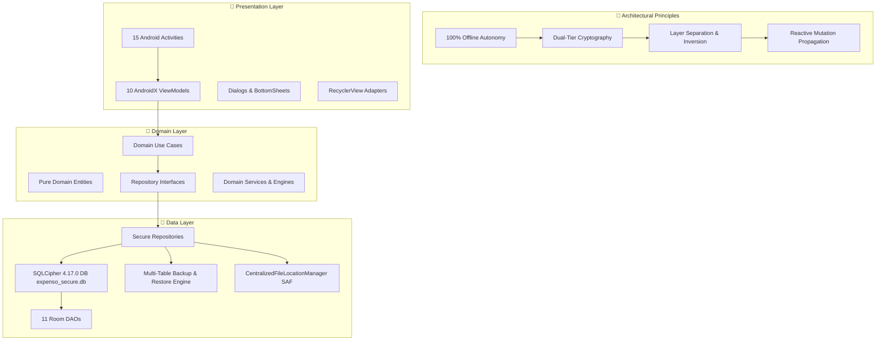
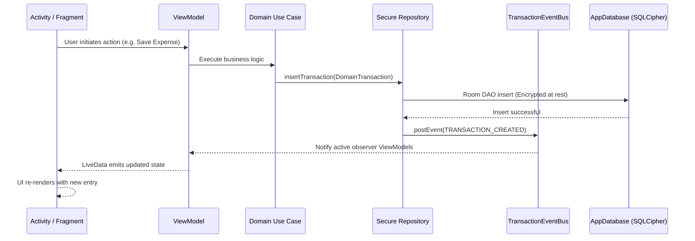
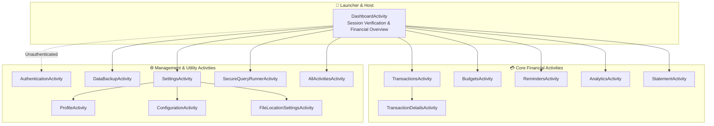
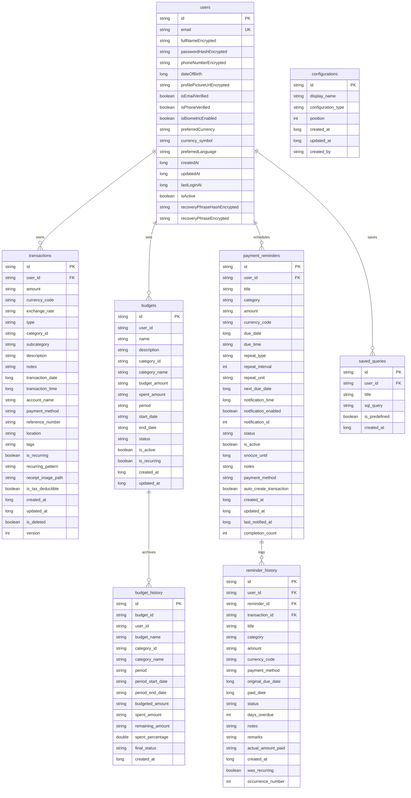
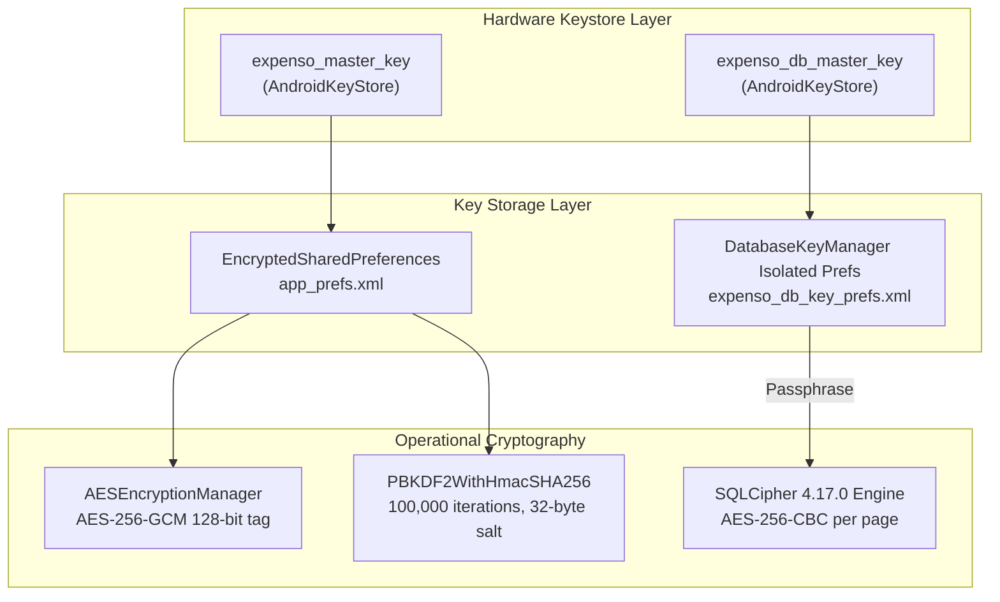
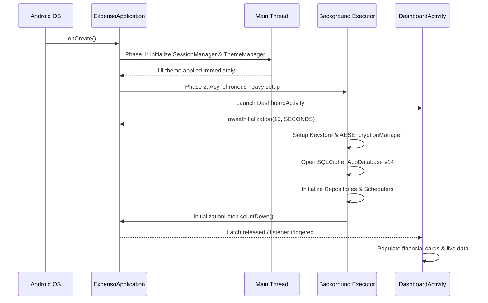

# Expenso - Architecture Guide

## 📋 Table of Contents

1. [System Architecture Overview](#️-system-architecture-overview)
2. [Architecture Principles](#-architecture-principles)
3. [Clean Layer Responsibilities](#-clean-layer-responsibilities)
4. [Data Flow Architecture & Event Bus](#-data-flow-architecture--event-bus)
5. [Component & Activity Architecture](#️-component--activity-architecture)
6. [Database Architecture & Schema (v14)](#️-database-architecture--schema-v14)
7. [Database Migration History (v1 to v14)](#-database-migration-history-v1-to-v14)
8. [Security & Cryptography Architecture](#-security--cryptography-architecture)
9. [Application Lifecycle & Two-Phase Startup](#-application-lifecycle--two-phase-startup)
10. [Background Scheduling & Workers](#-background-scheduling--workers)
11. [Package Structure](#-package-structure)
12. [Performance & Android 15/16 Compatibility](#-performance--android-1516-compatibility)
13. [Related Documentation](#-related-documentation)

---

## 🏗️ System Architecture Overview

Expenso implements **Clean Architecture** combined with **Model-View-ViewModel (MVVM)**, an asynchronous two-phase initialization lifecycle, and an in-memory reactive event bus (`TransactionEventBus`). It operates strictly **100% offline** with zero remote servers, cloud sync, or external analytics SDKs.



---

## 📐 Architecture Principles

1. **Strict Offline Independence**: No `INTERNET` permission in `AndroidManifest.xml`. All data processing, storage, analytics, and PDF generation execute locally on device.
2. **Dual-Tier Hardware-Backed Security**: SQLCipher 4.17.0 encrypts SQLite database pages on disk. Sensitive user profile credentials and security audit records use AES-256-GCM backed by Android Hardware Keystore (`AndroidKeyStore`).
3. **Decoupled Key Management**: `DatabaseKeyManager` maintains the SQLCipher passphrase in an isolated storage file (`expenso_db_key_prefs`) backed by its own dedicated MasterKey (`expenso_db_master_key`), preventing user preference resets from corrupting database accessibility.
4. **Reactive Mutation Propagation**: When repositories insert, update, or delete data, they notify `TransactionEventBus`. ViewModels observe this bus and update their `LiveData` reactively without continuous disk polling.
5. **Deterministic Two-Phase Startup**: Cold starts are divided into a fast synchronous path on the main thread and a heavy asynchronous path on a background thread pool, synchronized via `CountDownLatch` and `InitializationListener`.

---

## 🎯 Clean Layer Responsibilities

### 1. Presentation Layer (`com.offline.expenso.presentation`)
- **Activities & Dialogs**: Render UI, handle user touch events, and observe ViewModels.
- **ViewModels**: Extend `BaseViewModel`, encapsulate UI state within private `MutableLiveData`, and expose read-only `LiveData`.
- **Adapters**: Bind datasets to Material Design 3 `RecyclerView` components using `DiffUtil` for smooth 60 FPS transitions.
- **Theming**: `ThemeManager` applies Light, Dark, or System themes before layout inflation.

### 2. Domain Layer (`com.offline.expenso.domain`)
- **Entities**: Clean business models (`Budget`, `BudgetHistory`, `DomainTransaction`, `Money`, `User`, `Category`, `Configuration`, `PasswordResetToken`, `RecoveryPhrase`, `StatementData`).
- **Use Cases**: Encapsulate single business actions (`ComputeBudgetSpendingUseCase`, `StatementGeneratorUseCase`).
- **Domain Services**: Business rules including `RecurrenceEngine` (due date arithmetic), `AuthenticationService`, `PasswordResetService`, `RecoveryPhraseService`, and `ConfigurationValidationService`.
- **Repository Contracts**: Pure interfaces defining data requirements without framework dependencies (`TransactionRepository`, `BudgetRepository`, `UserRepository`).

### 3. Data Layer (`com.offline.expenso.data`)
- **Repositories**: Coordinate between Room DAOs, local preferences, and cryptography (`TransactionSecureRepository`, `BudgetRepository`, `UserSecureRepository`, `PaymentReminderRepository`, etc.).
- **Persistence (`AppDatabase`)**: Room database encrypted by SQLCipher 4.17.0. Current version: 14.
- **Backup & Restore**: Multi-table CSV export and import into compressed `.zip` archives with foreign-key collision resolution (`UserIdRemapper`).
- **File Management**: `CentralizedFileLocationManager` handles Storage Access Framework (SAF) tree URIs with fallback to app-scoped document directories.

---

## 🔄 Data Flow Architecture & Event Bus

Mutations follow a clean unidirectional data flow:



---

## 🏛️ Component & Activity Architecture

Expenso employs an activity-based navigation architecture where [`DashboardActivity`](file:///d:/Projects/expenso/expenso-android/app/src/main/java/com/offline/expenso/presentation/ui/activities/DashboardActivity.java) acts as the launcher and primary host:



---

## 🗄️ Database Architecture & Schema (v14)

- **Database Engine**: Room 2.6.1 + SQLCipher 4.17.0 (AES-256-CBC)
- **Database File**: `expenso_secure.db`
- **Schema Location**: `app/schemas/com.offline.expenso.data.local.database.AppDatabase/`

### Complete Entity-Relationship Model



---

## 📜 Database Migration History (v1 to v14)

| Migration | Versions | Core Changes |
| :--- | :--- | :--- |
| `MIGRATION_5_6` | 5 → 6 | Added `recoveryPhraseHashEncrypted` and `recoveryPhraseEncrypted` to `users`. |
| `MIGRATION_6_7` | 6 → 7 | Created `budgets` table with recurring spending attributes. |
| **`MIGRATION_7_8`** | **7 → 8** | **Major Architecture Refactor**: Prior to version 8, transactions used individual column AES encryption (`amount_encrypted`, `description_encrypted`, `notes_encrypted`, etc.). This prevented SQLite index lookups, sorting, filtering, and aggregate queries. Because SQLCipher already transparently encrypts the entire SQLite database file at rest with page-level AES-256, column encryption on transactions was redundant and harmful. Migration 7→8 safely decrypted all records and recreated `transactions` with plain typed columns. |
| `MIGRATION_8_9` | 8 → 9 | Added `is_recurring` to `budgets` and created `budget_history` for archived period snapshots. |
| `MIGRATION_9_10` | 9 → 10 | Added composite indices to `configurations` table for faster type lookup. |
| `MIGRATION_10_11` | 10 → 11 | Created `payment_reminders` and `reminder_history` tables for bill alerts. |
| `MIGRATION_11_12` | 11 → 12 | Simplified `configurations` schema (reduced redundant columns), mapped `currency_symbol` directly into `users` (`₹`, `$`, `€`, `£`, `¥`, etc.). |
| `MIGRATION_12_13` | 12 → 13 | Added `position INTEGER NOT NULL DEFAULT 0` to `configurations` for drag-and-drop category ordering. |
| `MIGRATION_13_14` | 13 → 14 | Created `saved_queries` table for Query Runner persistence. |

---

## 🔐 Security & Cryptography Architecture



### Key Security Safeguards:
1. **Isolated Passphrase Management (`DatabaseKeyManager.java`)**: Ensures database availability is decoupled from user session state.
2. **Timing Attack Protection**: Password verification uses `MessageDigest.isEqual()` for constant-time byte comparisons.
3. **SafeQueryRunner AST Sandbox**: Direct SQL execution blocks destructive keywords (`DROP`, `DELETE`, `ALTER`, `INSERT`, `UPDATE`), injects mandatory `user_id` filtering, and caps results at 500 rows.

---

## ⏱️ Application Lifecycle & Two-Phase Startup

To prevent cold-start UI freezes while initializing heavy cryptographic providers:



---

## ⏰ Background Scheduling & Workers

1. **Daily Budget Resets (`BudgetResetWorker.java`)**:
   - Scheduled via AndroidX `WorkManager` daily periodic request.
   - Evaluates active recurring budgets against current time.
   - Moves spent amounts to `budget_history` and rolls dates forward.
2. **Exact Payment Reminders (`ReminderAlarmScheduler.java`)**:
   - Uses `AlarmManager.setExactAndAllowWhileIdle()` on Android 6.0+.
   - Checks `AlarmManager.canScheduleExactAlarms()` on Android 12+ (API 31+).
   - Direct notification actions handled by `ReminderActionReceiver`.

---

## 📦 Package Structure

```
com.offline.expenso/
├── ExpensoApplication.java                 # Lifecycle & init orchestrator
├── core/                                   # Platform tools
│   ├── logging/                            # AppLogger
│   ├── security/                           # BiometricManager
│   ├── threading/                          # AppExecutorService
│   └── updates/                            # AppUpdateManager
├── data/                                   # Data Layer
│   ├── analytics/                          # OfflineAnalyticsEngine
│   ├── backup/                             # Multi-table backup/restore
│   ├── budget/                             # BudgetResetWorker
│   ├── events/                             # TransactionEventBus
│   ├── file/                               # CentralizedFileLocationManager
│   ├── local/dao/                          # Room DAOs
│   ├── local/database/                     # AppDatabase, SafeQueryRunner
│   ├── local/preferences/                  # SecurePreferencesManager
│   ├── mappers/                            # Domain ↔ Entity mappers
│   ├── reminder/                           # RecurrenceEngine & Alarms
│   ├── repositories/                       # Secure repositories
│   ├── security/                           # Cryptography managers
│   └── statement/                          # PdfStatementGenerator
├── domain/                                 # Domain Layer
│   ├── entities/                           # Domain models
│   ├── enums/                              # Business enums
│   ├── repositories/                       # Repository interfaces
│   ├── services/                           # Domain logic services
│   ├── usecases/                           # Clean use cases
│   └── value_objects/                      # Money
└── presentation/                           # Presentation Layer
    ├── common/                             # Base classes & shimmer
    ├── theming/                            # ThemeManager
    └── ui/                                 # Activities, ViewModels, Adapters
```

---

## ⚡ Performance & Android 15/16 Compatibility

1. **16KB Memory Page Size**: NDK packaging configured for 16KB ELF alignment across all target ABIs (`armeabi-v7a`, `arm64-v8a`, `x86`, `x86_64`) for Android 15+ kernels.
2. **In-Memory Reactive Caching**: Repositories cache computed balances, eliminating redundant SQL transactions on repeated view visits.
3. **85% Jacoco Line Coverage**: CI pipeline enforces coverage threshold on unit tests (`./gradlew testDebugUnitTest jacocoTestCoverageVerification`).

---

## 📚 Related Documentation

- **[README.md](../README.md)** - Project overview and quick start.
- **[SECURITY.md](SECURITY.md)** - Cryptographic implementation details.
- **[USER_GUIDE.md](USER_GUIDE.md)** - Complete user manual.
- **[QUERY_RUNNER.md](QUERY_RUNNER.md)** - Safe Query Runner guide and schema.
- **[FEATURES.md](FEATURES.md)** - Full feature specifications.