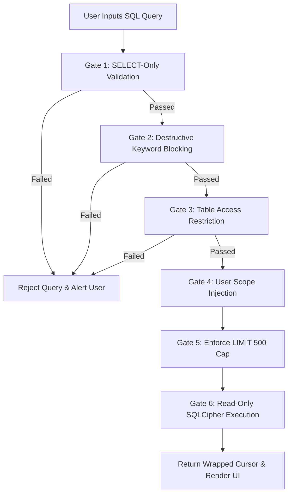

# Query Runner - Developer & User Guide

## 📋 Table of Contents

1. [Overview](#-overview)
2. [Features & Capabilities](#-features--capabilities)
3. [Security Architecture & AST Sandbox](#️-security-architecture--ast-sandbox)
4. [Saved Queries & Predefined Templates](#-saved-queries--predefined-templates)
5. [Complete Transaction Table Schema](#-complete-transaction-table-schema)
6. [Sample SQL Queries](#-sample-sql-queries)
7. [CSV Export Workflow](#-csv-export-workflow)
8. [Pros & Cons Analysis](#-pros--cons-analysis)
9. [Best Practices & Troubleshooting](#-best-practices--troubleshooting)
10. [Related Documentation](#-related-documentation)

---

## 🎯 Overview

The **Query Runner** (`SecureQueryRunnerActivity.java`) is an advanced feature in Expenso that enables developers and power users to execute custom SQL queries against the local encrypted `transactions` table. It bridges the gap between predefined UI reports and ad-hoc financial analytics while maintaining a zero-trust, read-only sandbox.

### Key Characteristics
- **Read-Only Access**: Strictly restricted to `SELECT` queries. All DDL and DML operations are blocked.
- **User-Scoped Isolation**: Queries automatically inject current `user_id` filtering to guarantee multi-tenant data boundaries.
- **Encrypted at Rest**: Operates directly on SQLCipher 4.17.0 encrypted database pages with hardware-isolated credentials.
- **Saved Queries Support**: Save, name, and execute favorite SQL queries backed by the `saved_queries` table.
- **CSV Export**: Export query outputs to local storage using the Storage Access Framework (SAF).

---

## ✨ Features & Capabilities

1. **Custom SQL Query Execution**
   - Write and execute arbitrary `SELECT` statements directly on device.
   - Dynamic column detection with responsive `RecyclerView` rendering.
2. **Saved Queries Management**
   - Save frequently used queries with custom titles into the `saved_queries` database table.
   - Load pre-built query templates for instant financial analysis.
3. **Automatic User Isolation**
   - The query runner AST parser verifies and injects `WHERE user_id = ?` to ensure users only access their own records.
4. **CSV Exporting**
   - Exports query results directly into CSV files with proper character escaping.
   - Saved to user-selected folders via Storage Access Framework (SAF).
5. **Memory Safety & Row Capping**
   - Automatically enforces a strict `LIMIT 500` to prevent Out-Of-Memory (OOM) exceptions.
   - Auto-closeable cursor wrappers prevent SQLite connection leaks.

---

## 🛡️ Security Architecture & AST Sandbox

Queries submitted to `SafeQueryRunner.java` must pass 6 verification gates before execution:



### The 6 Security Gates:
1. **Gate 1 - Query Type Validation**: Queries must begin with `SELECT`.
2. **Gate 2 - Keyword Blocking**: Any query containing `DROP`, `DELETE`, `ALTER`, `INSERT`, `UPDATE`, `ATTACH`, `DETACH`, `CREATE`, `REPLACE`, `TRUNCATE`, `PRAGMA`, or `VACUUM` is immediately rejected.
3. **Gate 3 - Table Access Restriction**: Only queries referencing the `transactions` table (or views) are permitted.
4. **Gate 4 - Automatic User Scope Enforcement**:
   - If no `WHERE` clause exists: Appends `WHERE user_id = '<current_user_id>'`.
   - If `WHERE` exists: Injects `AND user_id = '<current_user_id>'`.
   - Single quotes in `user_id` are strictly escaped (`''`).
5. **Gate 5 - Row Limit Guardrail**: If `LIMIT` is missing or exceeds 500, `LIMIT 500` is enforced.
6. **Gate 6 - Read-Only Connection**: Query executes against SQLCipher using read-only cursor semantics.

---

## 💾 Saved Queries & Predefined Templates

Added in database version 14 (`MIGRATION_13_14`), the `saved_queries` table allows users to persist queries for future execution.

### Built-in Predefined Queries:
1. **Recent Expenses**:
   ```sql
   SELECT description, amount, currency_code, category_id, transaction_date 
   FROM transactions 
   WHERE type = 'EXPENSE' AND is_deleted = 0 
   ORDER BY transaction_date DESC LIMIT 25
   ```
2. **Monthly Category Totals**:
   ```sql
   SELECT category_id, COUNT(*) AS count, SUM(CAST(amount AS REAL)) AS total 
   FROM transactions 
   WHERE type = 'EXPENSE' AND is_deleted = 0 
   GROUP BY category_id 
   ORDER BY total DESC
   ```
3. **Payment Method Analysis**:
   ```sql
   SELECT payment_method, COUNT(*) AS count, SUM(CAST(amount AS REAL)) AS total 
   FROM transactions 
   WHERE is_deleted = 0 
   GROUP BY payment_method
   ```

---

## 📊 Complete Transaction Table Schema

The `transactions` table contains the following fields available for custom queries:

| Column Name | SQLite Type | Room Definition | Description & Sample Values |
| :--- | :--- | :--- | :--- |
| `id` | `TEXT` | Primary Key, Not Null | Unique transaction UUID (e.g. `"550e8400-e29b..."`) |
| `user_id` | `TEXT` | Foreign Key (users.id) | Owning user account ID (automatically filtered) |
| `amount` | `TEXT` | Plain Text in Encrypted DB | Financial amount (e.g. `"150.00"`). Use `CAST(amount AS REAL)` for math |
| `currency_code`| `TEXT` | Nullable | ISO currency code (e.g. `"USD"`, `"INR"`, `"EUR"`) |
| `exchange_rate`| `TEXT` | Nullable | Multi-currency exchange rate string (e.g. `"1.0"`) |
| `type` | `TEXT` | Not Null | Transaction classification: `'INCOME'`, `'EXPENSE'`, `'TRANSFER'` |
| `category_id` | `TEXT` | Indexed | Category identifier (e.g. `"food"`, `"utilities"`) |
| `subcategory` | `TEXT` | Nullable | Secondary category classification |
| `description` | `TEXT` | Nullable | User-entered transaction summary |
| `notes` | `TEXT` | Nullable | Extended notes or memo |
| `transaction_date` | `INTEGER` | Not Null, Indexed | Date timestamp in milliseconds since epoch |
| `transaction_time` | `INTEGER` | Not Null, Indexed | Time timestamp in milliseconds since epoch |
| `account_name` | `TEXT` | Nullable | Account source (e.g. `"Checking"`, `"Wallet"`) |
| `payment_method` | `TEXT` | Indexed | Payment instrument (e.g. `"Cash"`, `"Credit Card"`, `"UPI"`) |
| `reference_number` | `TEXT` | Nullable | Check, transaction, or invoice number |
| `location` | `TEXT` | Nullable | Merchant or geographical location |
| `tags` | `TEXT` | Nullable | Comma-delimited tags (e.g. `"travel,tax,lunch"`) |
| `is_recurring` | `INTEGER` | Default 0 | Boolean flag (`1` if recurring, `0` otherwise) |
| `recurring_pattern` | `TEXT` | Nullable | JSON recurrence details |
| `receipt_image_path` | `TEXT` | Nullable | Local file URI for receipt attachment |
| `is_tax_deductible` | `INTEGER` | Default 0 | Boolean flag (`1` if tax-deductible, `0` otherwise) |
| `created_at` | `INTEGER` | Not Null | Record creation timestamp (epoch millis) |
| `updated_at` | `INTEGER` | Not Null | Last modification timestamp (epoch millis) |
| `is_deleted` | `INTEGER` | Default 0 | Soft deletion flag (`1` for deleted, `0` for active) |
| `version` | `INTEGER` | Default 1 | Entity version number for optimistic locking |

---

## 💡 Sample SQL Queries

### 1. Basic Expense Filtering
```sql
SELECT description, amount, payment_method, transaction_date 
FROM transactions 
WHERE type = 'EXPENSE' AND is_deleted = 0 
ORDER BY transaction_date DESC
```

### 2. High-Value Transactions (Above 500)
```sql
SELECT description, CAST(amount AS REAL) AS numeric_amount, category_id 
FROM transactions 
WHERE CAST(amount AS REAL) > 500 AND is_deleted = 0 
ORDER BY numeric_amount DESC
```

### 3. Date Range Search
```sql
SELECT description, amount, type, transaction_date 
FROM transactions 
WHERE transaction_date BETWEEN 1727740800000 AND 1730419199000 
  AND is_deleted = 0 
ORDER BY transaction_date ASC
```

### 4. Tag Pattern Matching
```sql
SELECT description, amount, tags 
FROM transactions 
WHERE tags LIKE '%vacation%' AND is_deleted = 0
```

### 5. Spending Breakdown by Category
```sql
SELECT category_id, 
       COUNT(*) AS total_txns, 
       ROUND(SUM(CAST(amount AS REAL)), 2) AS total_spent, 
       ROUND(AVG(CAST(amount AS REAL)), 2) AS avg_per_txn 
FROM transactions 
WHERE type = 'EXPENSE' AND is_deleted = 0 
GROUP BY category_id 
ORDER BY total_spent DESC
```

---

## 📤 CSV Export Workflow

1. Execute a valid `SELECT` query in the Query Runner.
2. Tap the **Export CSV** action in the top toolbar.
3. Select an output destination directory via the Android Storage Access Framework (SAF) folder picker.
4. Expenso generates a properly escaped `.csv` file containing header names and result rows, ready for Excel or Google Sheets.

---

## ⚖️ Pros & Cons Analysis

### Advantages
- ✅ **Ad-hoc Custom Reporting**: Extract any subset of financial data not covered by standard UI screens.
- ✅ **Mathematical Accuracy**: Supports standard SQLite aggregations (`SUM`, `AVG`, `ROUND`, `COUNT`).
- ✅ **Zero Leakage**: Enforced `WHERE user_id = ?` ensures multi-account isolation.
- ✅ **Favorite Queries**: Save and re-run complex queries with single-tap execution.
- ✅ **Offline Privacy**: Executed entirely within local SQLCipher memory.

### Limitations
- ❌ **Table Scoping**: Restricted to `transactions` table to prevent exposing cryptographic hashes in `users`.
- ❌ **Read-Only**: Write and modification statements are blocked by design.
- ❌ **500-Row Ceiling**: Large queries are capped at 500 records to prevent Android UI thread memory exhaustion.

---

## 🛠️ Best Practices & Troubleshooting

1. **Always Use `CAST(amount AS REAL)` for Calculations**: Because `amount` is stored as `TEXT` for precision across currencies, always cast to `REAL` before performing mathematical comparisons or aggregations (`SUM`, `>`, `<`).
2. **Exclude Deleted Transactions**: Add `WHERE is_deleted = 0` to your queries to avoid including soft-deleted items.
3. **Query Rejected Error**: If your query is rejected, ensure:
   - It begins strictly with `SELECT`.
   - It contains no prohibited keywords (`DELETE`, `UPDATE`, `DROP`, `ALTER`, etc.).
   - It references only the `transactions` table.

---

## 📚 Related Documentation

- **[README.md](../README.md)** - Application overview.
- **[ARCHITECTURE.md](ARCHITECTURE.md)** - Database design and Room v14 migrations.
- **[FEATURES.md](FEATURES.md)** - Full feature catalog.
- **[USER_GUIDE.md](USER_GUIDE.md)** - End-user manual.
