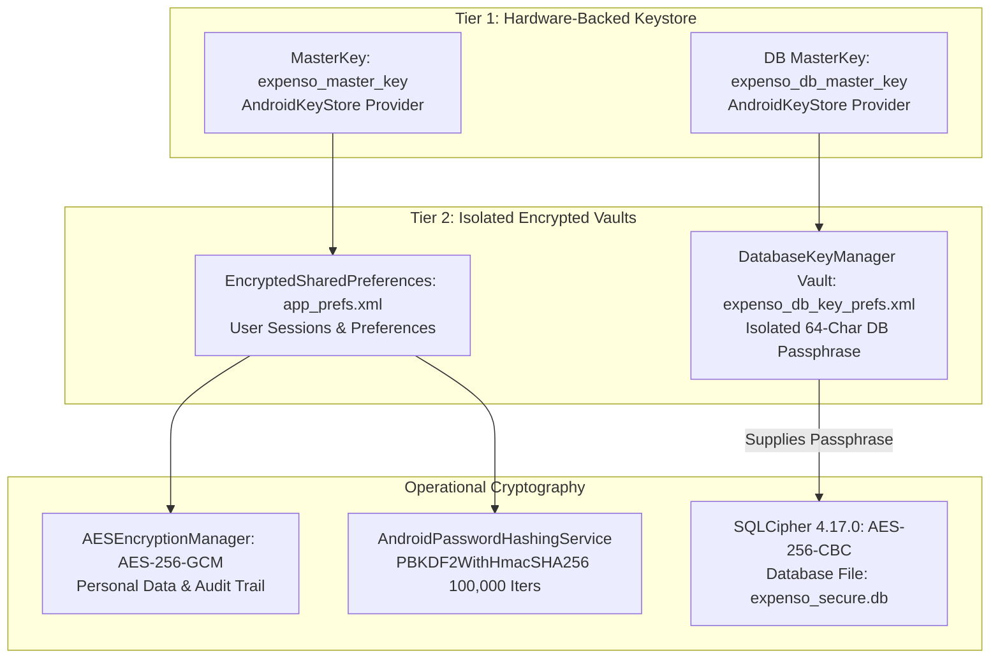

# Expenso - Security & Cryptographic Architecture

## 📋 Table of Contents

1. [Security Philosophy](#-security-philosophy)
2. [Dual-Tier Cryptographic Architecture](#-dual-tier-cryptographic-architecture)
3. [Database Encryption (SQLCipher 4.17.0)](#-database-encryption-sqlcipher-4170)
4. [Isolated Database Key Management](#-isolated-database-key-management)
5. [Column-Level Encryption (AES-256-GCM)](#-column-level-encryption-aes-256-gcm)
6. [Password & Recovery Hashing (PBKDF2)](#-password--recovery-hashing-pbkdf2)
7. [Session Security & Lifetime](#-session-security--lifetime)
8. [Safe Query Runner Sandbox](#-safe-query-runner-sandbox)
9. [Runtime Integrity & Audit Logging](#-runtime-integrity--audit-logging)
10. [Cryptographic Corruption Recovery](#-cryptographic-corruption-recovery)
11. [Security Checklist for Developers](#-security-checklist-for-developers)
12. [Related Documentation](#-related-documentation)

---

## 🔒 Security Philosophy

Expenso operates on a strict **Zero-Trust, Zero-Telemetry, 100% Offline** security model:
- **Zero Remote Dependency**: Absolute absence of `android.permission.INTERNET`. No remote synchronization, analytics pings, or cloud servers.
- **Hardware-Backed Cryptography**: All master encryption keys reside in the Android Hardware Keystore (backed by TEE / StrongBox Keymaster where available).
- **Defense in Depth**: Database files on disk are fully encrypted with SQLCipher, sensitive credential fields utilize column-level AES-GCM, and direct SQL queries are strictly AST-sandboxed.

---

## 🛡️ Dual-Tier Cryptographic Architecture



---

## 🗄️ Database Encryption (SQLCipher 4.17.0)

- **Library**: `net.zetetic:sqlcipher-android:4.17.0`
- **Algorithm**: OpenSSL AES-256-CBC with HMAC-SHA512 page integrity checking.
- **Scope**: Every SQLite database page, WAL (Write-Ahead Logging) journal, shared-memory file (`-shm`), and temporary file is encrypted on storage.
- **Database File**: `expenso_secure.db`
- **Performance Evolution (Migration 7→8)**:
  Prior to version 8, transactions used redundant column-level AES encryption (`amount_encrypted`, etc.). Because SQLCipher already transparently encrypts all SQLite pages on disk, Migration 7→8 safely decrypted transaction columns into plain typed SQLite columns (`amount`, `category_id`, etc.), restoring B-tree indexing, sorting, and aggregate queries (`SUM`, `AVG`) without sacrificing disk security.

---

## 🔑 Isolated Database Key Management

### Class: `DatabaseKeyManager.java`

To eliminate the risk of database lockout caused by user session preference resets, the SQLCipher database passphrase is completely isolated:

1. **Independent Vault**: Retains the passphrase inside a dedicated `EncryptedSharedPreferences` (`expenso_db_key_prefs`).
2. **Dedicated Hardware MasterKey**: Encrypted with its own Keystore alias (`expenso_db_master_key`).
3. **High-Entropy Generation**: On initial launch, generates a 64-character hexadecimal string using `SecureRandom`:
   ```java
   byte[] randomBytes = new byte[32]; // 256 bits of entropy
   new SecureRandom().nextBytes(randomBytes);
   String passphrase = bytesToHex(randomBytes);
   ```
4. **Resilience**: Even if app preferences or session caches are cleared, the database passphrase remains intact and accessible.

---

## 🔐 Column-Level Encryption (AES-256-GCM)

### Class: `AESEncryptionManager.java`

Used for sensitive user identity fields (`fullNameEncrypted`, `passwordHashEncrypted`, `phoneNumberEncrypted`, `recoveryPhraseEncrypted`) and security audit logs (`security_audit`):

- **Algorithm**: `AES/GCM/NoPadding`
- **Key Length**: 256 bits
- **Authentication Tag**: 128 bits
- **Initialization Vector (IV)**: 12 unique random bytes generated per encryption operation via `SecureRandom`.
- **Payload Layout**: `[12-byte IV] + [Ciphertext + 16-byte Auth Tag]`, Base64-encoded for database storage.
- **Keystore Fallback**: Automatically catches `AEADBadTagException` and Keystore invalidation, regenerating versioned keys if hardware credentials are reset.

---

## 🔢 Password & Recovery Hashing (PBKDF2)

### Class: `AndroidPasswordHashingService.java`

User authentication and account recovery phrase verification use industry-standard password-based key derivation:

- **Algorithm**: `PBKDF2WithHmacSHA256`
- **Iteration Count**: `100,000` iterations (computationally expensive to thwart brute-force cracking)
- **Salt Generation**: 32 cryptographically random bytes per user account generated via `SecureRandom`.
- **Key Length**: 256 bits.
- **Constant-Time Verification**:
  ```java
  public boolean verifyPassword(String password, String storedHash, byte[] salt) {
      byte[] computedHash = hashPasswordBytes(password, salt);
      byte[] expectedHash = Base64.decode(storedHash, Base64.NO_WRAP);
      return MessageDigest.isEqual(computedHash, expectedHash); // Prevents timing attacks
  }
  ```

---

## ⏱️ Session Security & Lifetime

### Class: `SessionManager.java`

- **Storage**: Hardware-backed `EncryptedSharedPreferences` (`app_prefs.xml`).
- **Inactivity Timeout**: Active sessions automatically expire after **24 hours** of user inactivity.
- **Biometric Integration**: Utilizes AndroidX `BiometricPrompt` with `BIOMETRIC_STRONG` crypto-object binding.
- **Sensitive Memory Clearing**: Password buffers and temporary byte arrays are zeroed out (`Arrays.fill(buffer, (byte) 0)`) immediately after hashing.

---

## 💻 Safe Query Runner Sandbox

### Class: `SafeQueryRunner.java`

Provides a direct SQL query console while enforcing strict execution boundaries:
1. **SELECT-Only Enforcement**: Blocks all DDL/DML tokens (`INSERT`, `UPDATE`, `DELETE`, `DROP`, `ALTER`, `CREATE`, `REPLACE`, `TRUNCATE`, `ATTACH`, `DETACH`).
2. **Mandatory User Scoping**: Parses the SQL AST and automatically appends `WHERE user_id = ?` (or `AND user_id = ?`) using parameterized escaping to prevent multi-tenant data leaks.
3. **Strict Row Ceiling**: Imposes an automatic `LIMIT 500` ceiling to safeguard against Out-Of-Memory exceptions.
4. **Connection Isolation**: Queries run on a read-only database cursor wrapped in autocloseable handlers to guarantee connection cleanup.

---

## 📝 Runtime Integrity & Audit Logging

### Class: `SecurityAuditLogger.java`

Maintains a tamper-evident audit trail recorded inside the encrypted `security_audit` table:
- **Tracked Events**:
  - `AUTH_LOGIN_SUCCESS` / `AUTH_LOGIN_FAILED`
  - `KEY_GENERATED` / `KEY_ROTATED`
  - `DATABASE_BACKUP_EXPORTED` / `DATABASE_RESTORED`
  - `SECURITY_SETTINGS_CHANGED`
- **Log Payload**: Encrypted using `AESEncryptionManager` to prevent forensic extraction from device backups.

---

## 🔄 Cryptographic Corruption Recovery

To handle hardware Keystore edge cases (such as biometric resets, OS updates, or corrupted preferences):
1. **Deep Exception Traversal**: `SessionManager` inspects underlying causes for `AEADBadTagException`, `KeyStoreException`, or `GeneralSecurityException`.
2. **Safe Re-initialization**: If session preferences become irrecoverably corrupted, `SessionManager` wipes corrupted preferences and prompts the user to re-authenticate using their master password or recovery phrase, preventing app boot loops.
3. **Database Immunity**: Because `DatabaseKeyManager` resides in an independent vault, session preference recovery has zero impact on SQLCipher database integrity.

---

## ✅ Security Checklist for Developers

When modifying the Expenso codebase, verify:
- [ ] No `android.permission.INTERNET` added to `AndroidManifest.xml`.
- [ ] No raw passwords, recovery phrases, or encryption keys printed in `AppLogger` or Android `Log`.
- [ ] All password and secret comparisons use `MessageDigest.isEqual()`.
- [ ] Room migrations never bypass `DatabaseKeyManager`.
- [ ] Direct queries route exclusively through `SafeQueryRunner`.
- [ ] Memory-sensitive byte buffers are wiped after use with `Arrays.fill(..., (byte)0)`.

---

## 📚 Related Documentation

- **[README.md](../README.md)** - Project overview.
- **[ARCHITECTURE.md](ARCHITECTURE.md)** - System design and Room v14 schema.
- **[QUERY_RUNNER.md](QUERY_RUNNER.md)** - Safe query execution guide.
- **[FEATURES.md](FEATURES.md)** - Detailed feature specifications.